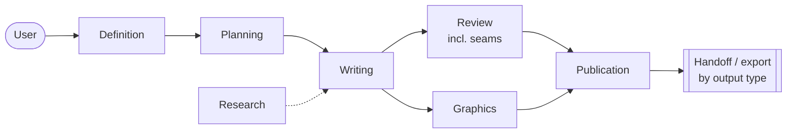

# Agentic Long-Form Content

Writing full-length books, research reports, screenplays and audiobooks with
Claude Code, using teams of subagents and a repository as shared memory.

> Formerly *Agentic Book Writing*; generalised in v2 (2026-11-02). The GitHub
> repository is being renamed `Agentic-Long-Form-Content`; old URLs redirect.

**[`SPEC.md`](SPEC.md) is the source of truth for the pattern.** This repository
documents it; two others implement it.

## What this is for

One pattern, four output types, set by `[output] type` in the manifest
(`longform.toml`):

| Type | Production stage ends in |
| --- | --- |
| `book` | Typeset body, then the print-geometry handoff (`kdp-publishing`) |
| `report` | `dist/report.pdf` via pandoc + typst |
| `screenplay` | `dist/screenplay.fountain`, exported to PDF |
| `audiobook` | Spoken scripts, rendered per chapter, `dist/audiobook.m4b` |

Definition, planning, drafting and review are identical for all four; only
production branches. The rest of this README describes the original and
reference case, the book: producing a print-on-demand paperback — Lulu, KDP Create, or equivalent — that
carries educational, instructional or reference material which did not exist in
that form before. Manuals, field guides, technical references, documentation of a
system nobody has written down.

It is an agentic *research* pattern. The book is the delivery mechanism; the work
is research, structuring and writing. It is deliberately not built for producing
books at volume, and [§1.1 of the spec](SPEC.md#11-what-this-is-not) explains
which parts of the architecture would have to be removed to make it so.

## The problem it solves

One agent cannot write a long work — not because a manuscript will not fit in a
context window, but because quality degrades long before the window fills. A
single agent carrying a whole book restates itself, drifts in register, and
starts producing text that is locally fluent and globally empty.

So the architecture is **context management by delegation**: no agent is ever
given a task large enough to reach that region. The cost of that is that agents
cannot stay consistent by reading each other's work, so consistency is carried by
documents instead — a style guide, per-chapter briefs, a continuity ledger.
The joins between units are where this breaks most, so a dedicated
**seam-reviewer** reads only the join.

That trade is the whole pattern. Everything else follows from it.

## The teams

Detail, including who reads what, is in [`SPEC.md` §4](SPEC.md#4-agent-teams)
and [`docs/teams.md`](docs/teams.md).

## The three repositories

| Repository | What it is |
| --- | --- |
| **Agentic-Long-Form-Content** (this one; was Agentic-Book-Writing) | The spec and the documentation of the pattern |
| [Long-Form-Content-Plugin](https://github.com/danielrosehill/Long-Form-Content-Plugin) (plugin `long-form-content`; was Claude-Book-Writing-Plugin) | The Claude Code plugin: agents, skills, commands |
| [Long-Form-Content-Workspace-Template](https://github.com/danielrosehill/Long-Form-Content-Workspace-Template) (was Claude-Book-Workspace-Template) | The scaffold a project is instantiated from |

Split this way because they run on different clocks. The plugin is replaced
wholesale on `/plugin update`; a project lives for months and diverges from
the template forever; the spec changes more slowly than either.

## Related

[**KDP-Publishing-Plugin**](https://github.com/danielrosehill/KDP-Publishing-Plugin) —
takes a finished manuscript and produces a print-ready KDP paperback: trim
geometry, a full-wrap cover built last from the interior's measured extent, and
mechanical pre-flight. This pattern hands off to it rather than reimplementing
any of it, and the two are designed to meet at `dist/manuscript.json`.

The division is deliberate and runs both ways: that plugin states it does not
write your book, and this one does not typeset it. Typesetting and authorship
have different failure modes, and tools that bundle them tend to be good at
neither.

## Reading order

| Document | |
| --- | --- |
| [`SPEC.md`](SPEC.md) | The pattern, normative |
| [`docs/brief-as-given.md`](docs/brief-as-given.md) | Where the spec came from, unedited |
| [`docs/context-problem.md`](docs/context-problem.md) | Why one agent cannot do this |
| [`docs/teams.md`](docs/teams.md) | Each team, its inputs and its outputs |
| [`docs/documents.md`](docs/documents.md) | The foundational documents and who owns what |
| [`docs/delegation.md`](docs/delegation.md) | Read-scoping and the parallelism rules |
| [`docs/publication.md`](docs/publication.md) | Concatenation, typesetting, the handoff |
| [`docs/failure-modes.md`](docs/failure-modes.md) | What goes wrong, and which rule prevents it |

## Status

**v2** (2026-11-02). v1 covered books only; v2 adds the report, screenplay and
audiobook output types and the seam-reviewer ([changelog](SPEC.md#changelog)).
The pattern has been used by hand to produce printed books; this is the work of
making it repeatable. [§8 of the spec](SPEC.md#8-open-questions) lists what it
does not answer — revision passes after first assembly being the largest.

MIT.
