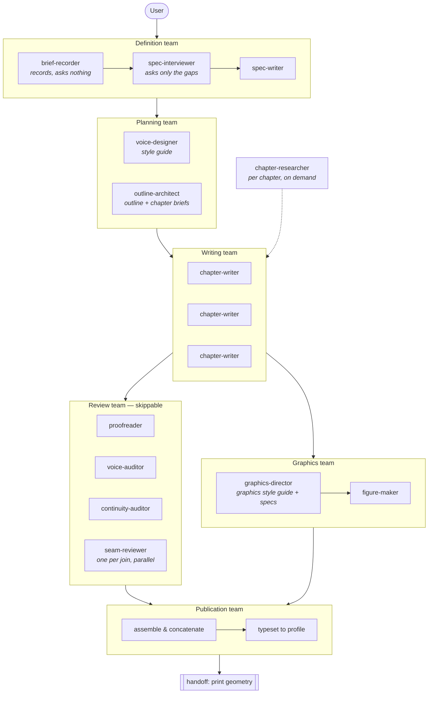

# Pattern specification — v2

**Status:** v2, 2026-11-02 (v1 settled 2026-08-19) · **Source:** [`docs/brief-as-given.md`](docs/brief-as-given.md)

This is the source of truth for the pattern. The plugin and the workspace
template are implementations of it, and either one is wrong where it disagrees
with this document. Changes to the pattern are changes to this file first.

Versioned because the pattern will change. v1 is what has been done by hand and
is now being made repeatable; it is not a claim that the design is finished.
v2 generalises the pattern from books to long-form content; see
[§1.3](#13-output-types) and the [changelog](#changelog). Where this document
says "book" or "chapter" without qualification, read it as the `book` case and,
for the other types, "the work" and "unit".

---

## 1. What this is

An **agentic research pattern whose reference form factor is a printed book**,
generalised in v2 to other long-form outputs (§1.3).

The output is a print-on-demand paperback — Lulu, KDP Create, or equivalent —
carrying educational, instructional or reference material that did not exist in
that form before. The book is the delivery mechanism. The work is research,
structuring and writing.

### 1.1 What this is not

This is not a system for volume-producing books to sell. The distinction is not
a disclaimer, it is a design constraint that shows up in the architecture:

- The pipeline is **front-loaded onto definition**. A user who cannot say what
  gap the book fills does not get past intake. A generator optimised for volume
  would make that stage optional; here it gates everything.
- The pipeline is **evidence-bound**. Writing agents that cannot reach a fact
  leave a marker rather than produce fluent text around the hole, and the marker
  is a hard failure before production.
- The unit of value is **one book that is worth printing**, not throughput.

A system built for volume would drop all three, and would be a different system.

### 1.2 Why print at all

Print is a forcing function. It fixes the content at a date, it makes length a
real constraint rather than a slider, and it removes the option of patching after
publication. Reference material written to be printed gets scoped, ordered and
checked in a way the same material written to a wiki does not.

### 1.3 Output types

The manifest (`longform.toml`, formerly `book.toml`; old workspaces still load)
sets `[output] type`. **Definition, planning, drafting and review are identical
for all four; only the production stage branches.**

| Type | Units | Production | Artefact |
| --- | --- | --- | --- |
| `book` | Chapters | Typeset body, print-geometry handoff to `kdp-publishing` | `dist/manuscript.md`, `.json` |
| `report` | Sections/chapters | `longform.py export`: pandoc + typst | `dist/report.pdf` |
| `screenplay` | Fountain files; a "chapter" unit is a sequence of scenes one writer owns | `assemble`, then `export` via afterwriting/screenplain or a configured `export_cmd` | `dist/screenplay.fountain`, PDF |
| `audiobook` | Chapters | Narration adaptation, `render`, `audio-assemble` (§4.7.1) | `dist/audiobook.m4b`, `dist/audiobook.json` |

For screenplays the continuity ledger gains **Characters**, **Locations** and
**Timeline** tables.

---

## 2. The problem the architecture solves

**One agent cannot write a long work.**

Not primarily because a book exceeds a context window — increasingly it does not
— but because quality degrades long before the window fills. A single agent
carrying an entire manuscript produces recognisable failures in the middle: it
restates what it said earlier, drifts in register, loses the thread of its own
argument, and starts generating text that is locally fluent and globally empty.

So the architecture's whole purpose is **context management by delegation**: no
single agent is ever given a task large enough to reach that region.

Everything in this spec follows from that one constraint. When a design question
comes up, the question to ask is: *does this keep some agent's working set
small?* If it does not, it is decoration.

### 2.1 The corollary that is easy to miss

If agents do not read each other's work, they cannot stay consistent by reading.
Consistency must therefore be carried by **artefacts** — a style guide, a set of
chapter briefs, a continuity ledger — that are small enough to hand to every
agent cheaply.

This is the central trade of the pattern: **replace shared context with shared
documents.** Most of the machinery below is an instance of it.

---

## 3. Foundational documents

Created before any prose. Each is the single owner of its subject, saved in the
project repository, and read by agents rather than inferred by them.

| Document | Owns | Ships in the book? |
| --- | --- | --- |
| Spec | What the work is, who for, scope, target length | No |
| Style guide | Tone of voice, register, prose conventions | No |
| Graphics style guide | Visual language for all figures | No |
| Outline | Chapter map, boundaries, drafting order | **No** |
| Unit briefs | The contract for one unit (chapter) | No |
| Continuity ledger | What the book has established, and where | No |
| Manifest | Structure, status, continuity keys, machine-readable | No |

**The outline never enters the book.** It exists purely to guide the writing
agents and any human co-author. This is stated explicitly because the natural
drift is for an outline to become a preface or a chapter zero, and it must not.

### 3.1 The chapter brief is the load-bearing document

A brief is what a chapter-writing agent gets *instead of* the rest of the book.
It must therefore carry everything that keeps the chapter consistent with work
the agent will never see:

- the argument the chapter makes, in one paragraph
- what the reader can do afterwards
- what earlier chapters have already established, so it is not re-explained
- what this chapter establishes for later chapters to rely on
- what it must cover, and **what it must not cover** — the boundary with its
  neighbours
- its sources
- a summary of the chapters either side
- a **Seams** section: "Picks up from" (the state the previous unit leaves the
  reader or story in) and "Hands off to" (what the next unit will assume)

The last three items are what a writer would otherwise get by reading adjacent
drafts. The Seams section is the controlled substitute for reading neighbours. If briefs are thin, agents compensate by reading, and the architecture
collapses back to one big context.

---

## 4. Agent teams

Work is organised into teams. A team is a stage with its own inputs, its own
output artefacts, and its own agents; teams hand off through the repository, not
through conversation.

### 4.1 Definition team

Two agents, deliberately separated:

- **brief-recorder** takes the user's statement of what they want and saves it to
  the repository **without asking questions and without interpreting it.** The
  original framing — including emphasis and omissions — is evidence, and it is
  unrecoverable once paraphrased.
- **spec-interviewer** then asks only the questions whose answers change the
  work, and only those the brief has not already answered. Its job is to fill the
  blanks the orchestrator and the writing team will need, not to conduct a
  general interview.

Splitting these is a design decision, not tidiness: an agent that records and
questions in the same turn will lead the witness.

**spec-writer** settles both into the book spec.

### 4.2 Planning team

Produces the style guide, the outline, and one brief per chapter. This is the
stage that determines whether parallel drafting is possible, because the briefs
are what make chapters independent.

### 4.3 Research

A **single subagent**, not a team, invoked per chapter and working alongside the
writers. It produces notes into the repository that a chapter writer reads. It
does not draft, and it does not read drafts.

### 4.4 Writing team

Chapter-writing subagents, dispatched **in parallel**, one chapter each.

Each writer reads: its brief, the style guide, its research notes, the continuity
ledger, and the neighbour summaries. It does not read other chapters' drafts.

**Parallelism has one limit.** Two chapters that draw on the same source material
for the same purpose must not be drafted concurrently — two agents given the same
source will describe it differently and both descriptions will ship. Those go in
separate sequential batches.

### 4.5 Review team

Specialised reviewers, each with a narrow remit and a small working set:

- **proofreader** — mechanical correctness, one chapter at a time
- **voice-auditor** — drift from the style guide, sampled across chapters
- **continuity-auditor** — repetition, contradiction, unpaid promises; works
  whole-work from the ledger and lint, not on the joins
- **seam-reviewer** — the join between two adjacent units (§4.5.1)

Reviewers write findings; they do not edit prose. The writer applies findings.

**This team is skippable.** For some projects the user is comfortable going
straight from draft to publication, and the pattern permits it as an explicit
choice rather than an accident.

#### 4.5.1 Seam review

Because writers never read each other's units, the joins between adjacent units
are where agentic long-form work breaks most. Typical failures: the next unit
re-introduces what the last just said; both sides recap or preview; the opening
assumes a state the previous ending never left; a tonal jump. For screenplays,
add continuity of character position, time and props across the cut.

`longform.py seams` cuts each join into `review/seams/<a>__<b>.md`: the last
~350 words of unit N, the first ~350 of N+1, and the Seams section of both
briefs. One seam-reviewer per seam, in parallel, reads **only that file** and
writes `review/seams/<a>__<b>.review.md`, with findings addressed to one side or
to the outline. It never edits prose. Lint warns when both sides of a seam are
reviewed but the seam has no review, or the review predates an edit.

For audiobooks the seam pass runs again on the spoken scripts
(`longform.py seams --layer script`).

### 4.6 Graphics team

For technical and instructional books, figures are content, not decoration.

- **graphics-director** owns the graphics style guide and writes a spec per
  figure. The style guide is what makes thirty figures drawn in thirty separate
  invocations look like one book's figures.
- **figure-maker** produces individual illustrations and diagrams from specs.

### 4.7 Publication team

Owns concatenation of the manuscript, typesetting via Typst, and conformity to
the target channel's requirements — the user's chosen typesetting profile,
whether KDP, Lulu, or another.

**Per output type** (§1.3): `report` exports through pandoc + typst;
`screenplay` assembles Fountain files and exports to PDF; `audiobook` follows
§4.7.1. The boundary below applies to `book`.

**Boundary:** print *geometry* — trim, gutter, spine width, cover wrap and
pre-flight — is handed off to a dedicated tool rather than reimplemented, because
a cover must be built last from the finished interior's measured extent. The
publication team produces the manuscript and its metadata; the handoff produces
the printable artefact.

#### 4.7.1 Audiobook production

1. The manuscript stays the text of record. A **`narration-adapter`** agent
   produces a spoken script per chapter in `audio/script/`: text normalisation
   from written to spoken form (numbers, symbols, acronyms, URLs), no visual
   references, optional SSML.
2. `longform.py script-lint` checks each script. A pronunciation lexicon,
   `guides/pronunciation.md`, keeps cross-chapter consistency.
3. `longform.py render` runs an engine-agnostic `[audio] render_cmd` once per
   chapter, resumably.
4. `longform.py audio-assemble` joins chapters with gaps, loudness-normalises,
   embeds chapter marks, tags and cover, and writes `dist/audiobook.m4b` and
   `dist/audiobook.json`.

---

## 5. Process

1. **User defines the project** — why they want it, what it is about, approximate
   target length, and what material already exists.
2. **Definition and planning teams create the foundational documents** in the
   repository: spec, style guide, outline, chapter briefs, manifest.
3. **Research** runs per chapter as needed.
4. **Writing team drafts chapters in parallel**, each agent working from its
   brief alone.
5. **Review team runs its passes**, including the seam pass — optional, by explicit user choice.
6. **Graphics team produces figures** against the graphics style guide.
7. **Publication team produces the artefact** for the output type: for a book,
   concatenation and typesetting to the chosen profile.
8. **Handoff**: for a book, print geometry goes to `kdp-publishing` and the
   result to the POD channel.

Stages 5 and 6 are independent of each other and may run concurrently.

---

## 6. Shipped skills

The plugin ships, at minimum:

| Skill | Stage | Note |
| --- | --- | --- |
| Workspace creation | — | Instantiates a project repo from the template |
| Brief intake | Definition | Records only. Asks nothing. |
| Spec interview | Definition | Asks only what is missing and what changes the work |
| Spec authoring | Definition | Settles the book spec |
| Style guide authoring | Planning | |
| Outline and briefs | Planning | Produces the per-chapter contracts |
| Research | Research | Per chapter |
| Chapter drafting | Writing | Dispatches parallel writers with batch rules |
| Review passes | Review | Skippable; includes seam review |
| Graphics | Graphics | Style guide, specs, figures |
| Assembly and publication | Publication | Concatenate, typeset, hand off |
| Status | — | Manifest-driven progress |

---

## 7. Invariants

Statements that must remain true. A change that breaks one is a change to the
pattern, and belongs in a new version of this spec rather than in an implementation.

1. **No agent is given the whole book.** If any single invocation would need to
   hold the manuscript, the design is wrong.
2. **Consistency is carried by documents, not by shared context.**
3. **The outline never ships.**
4. **Writers do not read other chapters' drafts.**
5. **Reviewers do not edit prose.**
6. **Every foundational document has exactly one owner.** A second document
   describing structure, voice or scope is drift.
7. **A fact that cannot be reached is marked, not invented**, and an unresolved
   marker blocks production.
8. **The brief as given is preserved unedited**, separately from the spec derived
   from it.
9. **Print geometry is handed off, not reimplemented.**
10. **The workspace works standalone.** A clone with the plugin uninstalled can
    still lint, assemble and build.
11. **Joins are reviewed by an agent that reads only the join.** Adjacent units
    are never reconciled by giving one agent both in full.

---

## 8. Open questions

Carried into v2 rather than answered here.

- **How much review is enough?** The review team is skippable, but there is no
  principled account of when skipping it is safe.
- **How is a book revised after the first assembly?** The pattern is strong on
  first drafts and silent on second passes, which is where the outline may need
  to change under a manuscript that already exists.
- **Where does a human co-author intervene?** The outline is described as serving
  both agents and a human, but the handoff points are not specified.
- **Deliberate repetition.** A reference work sometimes *should* restate itself
  for readers who open it at chapter 9. The continuity ledger records these
  exceptions, but nothing yet decides them.
- **How volatile facts are handled** beyond a snapshot date — whether a printed
  reference work should carry decaying values at all.

---

## Changelog

**2026-11-02 — v2.** Generalised from book writing to long-form content (owner
decision, Daniel). Pattern renamed *Agentic Long-Form Content*; plugin is now
`long-form-content`, manifest `longform.toml` (was `book.toml`), script
`scripts/longform.py` (was `book.py`). Added: four output types (`book`,
`report`, `screenplay`, `audiobook`) with only production branching (§1.3,
§4.7.1); the **seam-reviewer** and `longform.py seams` (§4.5.1); a Seams section
in briefs (§3.1); invariant 11. v1 invariants 1-10 are unchanged.
