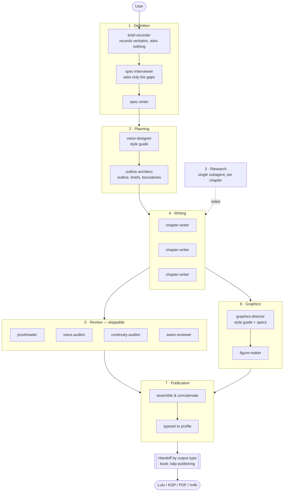

# The teams

This describes the `book` case; the other output types (report, screenplay,
audiobook) differ only in stage 7 — see [`SPEC.md` §1.3](../SPEC.md#13-output-types).

A team is a stage with its own inputs, its own output artefacts, and its own
agents. **Teams hand off through the repository, not through conversation** —
which is what allows a stage to be re-run, resumed weeks later, or inspected by a
human without replaying the session that produced it.

## 1 · Definition

**In:** whatever the user says. **Out:** `spec/brief.md`, `spec/interview.md`,
`spec/spec.md`.

| Agent | Does | Notably does not |
| --- | --- | --- |
| `brief-recorder` | Saves the brief as given | Ask anything, tidy anything, interpret anything |
| `spec-interviewer` | Asks the questions whose answers change the work | Ask what the brief already answers |
| `spec-writer` | Settles both into a spec | Add scope the user did not ask for |

Recording and questioning are **separate agents on purpose.** An agent doing both
in one turn leads the witness: it asks about the things it has already decided
are interesting, and the record it keeps is the record of that conversation
rather than of what the person came in wanting.

The interviewer's discipline is subtractive. Every question has to earn its place
by changing an outline, a voice, or a scope decision.

## 2 · Planning

**In:** the spec. **Out:** `guides/style-guide.md`, `outline/outline.md`,
`outline/briefs/*.md` (each with a Seams section), a populated `longform.toml`.

This stage decides whether parallel drafting is possible at all, because briefs
are what make chapters independent. A thin brief is not a small problem later; it
is the problem that shows up as an unusable chapter.

The style guide is written **before** the outline, because prose conventions
affect chapter sizing.

## 3 · Research

**In:** a chapter brief. **Out:** `research/notes/*.md`, rows in
`research/sources.md`.

One subagent, invoked per chapter, working alongside the writers rather than as a
phase before them. It does not draft and it does not read drafts. Keeping it
separate from writing means a writer's context holds notes rather than the search
process that produced them.

## 4 · Writing

**In:** one brief, the style guide, research notes, the continuity ledger,
neighbour summaries. **Out:** one chapter, plus ledger updates.

Writers run in parallel, one chapter each, and **never read another chapter's
draft.** The batching rule is in [`delegation.md`](delegation.md).

## 5 · Review — skippable

**In:** drafted chapters. **Out:** `review/reports/*.md`.

| Agent | Remit | Working set |
| --- | --- | --- |
| `proofreader` | Mechanical correctness, term consistency | One chapter |
| `voice-auditor` | Drift from the style guide | Samples across chapters |
| `continuity-auditor` | Repetition, contradiction, unpaid promises | Lint output + summaries |
| `seam-reviewer` | One join: re-introduction, double recap, assumed state, tonal jump | One seam file |

`longform.py seams` writes `review/seams/<a>__<b>.md` (last ~350 words of unit N,
first ~350 of N+1, the Seams section of both briefs). One seam-reviewer per
seam, in parallel, writes `<a>__<b>.review.md` with findings addressed to one
side or to the outline. Distinct from `continuity-auditor`, which works
whole-work and not on the joins. For audiobooks the pass reruns on spoken
scripts (`--layer script`).

**Reviewers write findings; they do not edit prose.** A reviewer that edits is a
second author with no brief, and its changes are invisible in a way an author's
are not.

Skippable by explicit user choice. The point of making it explicit is that
skipping it should be a decision someone made, not something that happened.

## 6 · Graphics

**In:** the spec, drafted chapters. **Out:** `guides/graphics-style-guide.md`,
`graphics/specs/*.md`, rendered assets.

The style guide is what makes thirty figures drawn in thirty separate agent
invocations look like one book's figures — the same problem as prose voice, with
the same solution.

Diagrams are **authored**, not generated. A generated diagram carries invented
labels and near-miss arrows, and neither survives print.

## 7 · Publication

**In:** `manuscript/`, a typesetting profile. **Out:** `dist/manuscript.md`,
`dist/manuscript.json`, typeset body.

Other types: `dist/report.pdf`; `dist/screenplay.fountain` + PDF; `audio/script/`
+ `dist/audiobook.m4b` (see [`publication.md`](publication.md)).

Concatenation, typesetting to the chosen profile, conformity to the channel.
Print geometry is handed off — see [`publication.md`](publication.md).
